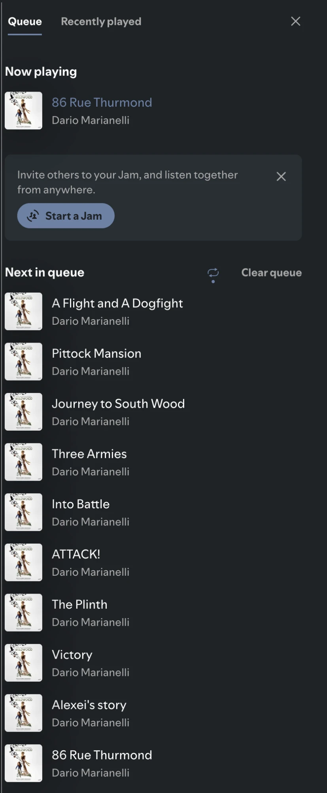

# Queue Loop

Put a few songs on repeat without making a playlist for them.

Queue Loop adds a loop button to the **Next in queue** header in Spotify's queue panel, next to **Clear queue**. Turn it on and the song playing now, plus everything in your queue, keeps cycling until you stop it.



## How it works

- **Turning it on** loops the song that's playing now and every song under *Next in queue*. Each song goes back to the end of the queue as it starts, so the order stays the same.
- **Songs you queue while it's on** join the loop. **Songs you remove** drop out of it.
- **Clearing the queue turns it off**, however the queue gets emptied: the *Clear queue* button, removing songs one at a time, or clearing it from another device.
- **Clicking the button again** turns it off. Whatever's left in the queue still plays once.
- The playlist or album playing underneath isn't touched. Once the loop is off and the queue runs out, it picks up where it left off.
- The loop starts off each time Spotify opens.

The button only shows when *Next in queue* has songs in it. Open the queue panel with the queue icon in the bottom-right of the player.

## Install

**From the Marketplace:** search for *Queue Loop* in the Spicetify Marketplace and click Install.

**Manually:**

1. Copy `queueLoop.js` into your Spicetify extensions folder. Run `spicetify path userdata` to find it; the file goes in its `Extensions` folder.
2. Run:

   ```bash
   spicetify config extensions queueLoop.js
   spicetify apply
   ```

To uninstall a manual install, run `spicetify config extensions queueLoop.js-` then `spicetify apply`.
